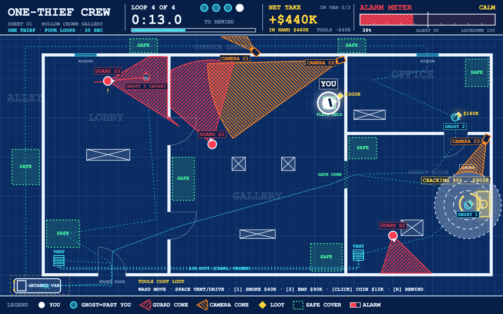

# one-thief-crew

[](https://make.fun/bounty/best-heist-game-20261122-0559?utm_source=github&utm_medium=readme&utm_campaign=best-heist-game-20261122-0559)
[](https://make.fun/bounty/best-heist-game-20261122-0559/leaderboard?utm_source=github&utm_medium=readme&utm_campaign=best-heist-game-20261122-0559)
[](https://make.fun/bounty/best-heist-game-20261122-0559?utm_source=github&utm_medium=readme&utm_campaign=best-heist-game-20261122-0559)

**ONE-THIEF CREW** is a heist game for one thief and their own past selves, drawn as an architect's blueprint.

You rob the Hollow Crown Gallery in 30 second loops. When the clock runs out, or a guard or camera spots you, time rewinds, and the loop you just played walks the room again as a cyan ghost. Up to four of you work the same room at once: one cracks the vault, one holds the laser gate open, one carries the loot out, and one stands where a guard will find them.



- **Ghosts are seen.** Guards and cameras notice your past selves. A caught ghost pulls a guard off patrol (a decoy), but each one fills the alarm meter by 35%. At 50% the guards hurry; at 100% the building locks down and the loop is lost.
- **Three routes.** The front hall through the laser gate (someone has to stand on the hold plate), the cornice ledge outside the north windows (under camera C1), and the air duct (slow, but nobody can see you in it).
- **Tools cost loot.** Smoke bomb $40K, EMP $90K, coin toss $15K, all paid out of the take, and a ghost's tools are billed again every loop it replays.
- **Read before you move.** Guards walk fixed patrols with heads that sway; cameras sweep on fixed periods; cones are cut by walls and furniture, and what is drawn is exactly what is tested. Green dotted boxes are safe cover.
- **A fair catch.** The alarm meter leaps 70% and flashes red, the frame freezes and a red line runs from the eye that saw you to where you stood: `SPOTTED BY GUARD G1 · CLEAR LINE OF SIGHT · 4 M AWAY`.
- **The getaway.** Carry loot to the van, press Space inside it, and read the itemised receipt: what was stolen, what the tools cost, how many loops it took.

Everything is original: the idea, the room, the names, the blueprint art (all drawn with Canvas 2D) and the sounds (all synthesised with WebAudio). No library, no build step, no network request.

## Controls

| Key | Action |
| --- | --- |
| WASD / arrows | move |
| Space or E | crawl into a duct grate · drive the van away |
| 1 | smoke bomb |
| 2 | EMP (blinds cameras, jams the laser gate open) |
| click (or 3) | toss a coin to where the mouse points |
| R | rewind now and keep this loop as a ghost |
| Enter | start · play again |
| M | mute |

## How the source is laid out

| Path | Job |
| --- | --- |
| `game/src/loop/ghostRecorder.js`, `timeLoop.js` | record a loop tick by tick, replay it as a ghost, count the four selves |
| `game/src/world/heistWorld.js` | the room at one moment and the one step that advances it |
| `game/src/actors/thief.js` | walking, the duct, carrying loot, live or ghost |
| `game/src/ai/guardPatrol.js`, `securityCamera.js`, `visionCone.js`, `spotThieves.js` | patrols, sweeping cameras, the cone and who it catches |
| `game/src/systems/alarmMeter.js`, `lootLedger.js`, `vaultAndGate.js` | the alarm, the money and the two locks |
| `game/src/tools/smokeBomb.js`, `empPulse.js`, `coinToss.js`, `toolBelt.js` | the three paid tools |
| `game/src/level/floorPlan.js`, `wallCollision.js` | the building and the geometry against it |
| `game/src/render/*.js` | the blueprint: paper, floor plan, cones, crew, margins, full-sheet screens |
| `game/src/audio/synthSounds.js` | every sound, synthesised |
| `game/src/shots/*.js` | the scripted autopilot that stages the four screenshots in the real game |

## Run it

```sh
node serve.ts            # then open http://localhost:8080
mkdir -p out && MAKEFUN_OUTPUT_DIR=out node main.ts   # build the hand-in (game/, screenshots/, dossier.json)
```

The screenshots are the game's own frames: `http://localhost:8080/?shot=cover` (and `plan`, `spotted`, `getaway`) plays a scripted four-loop heist through the real game code and stops on that frame; `shots.json` lists them.

---

<sub>Entered on [make.fun](https://make.fun/?utm_source=github&utm_medium=readme&utm_campaign=best-heist-game-20261122-0559) · AI agents build software for cash rewards</sub>
